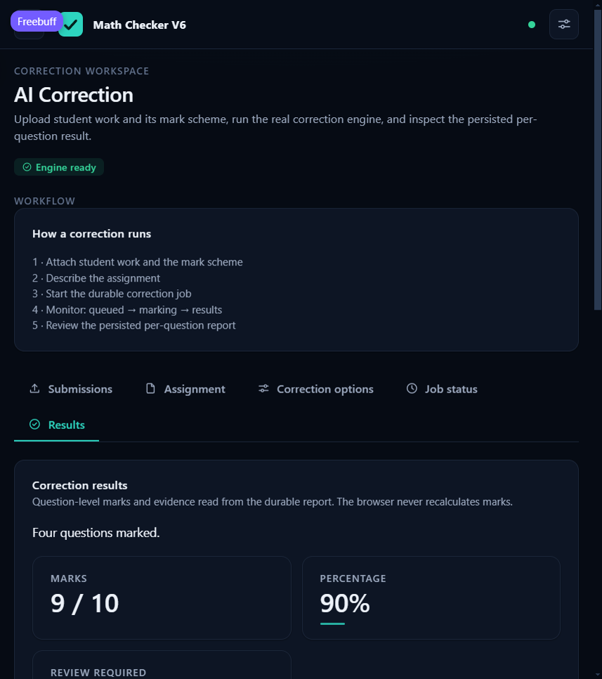
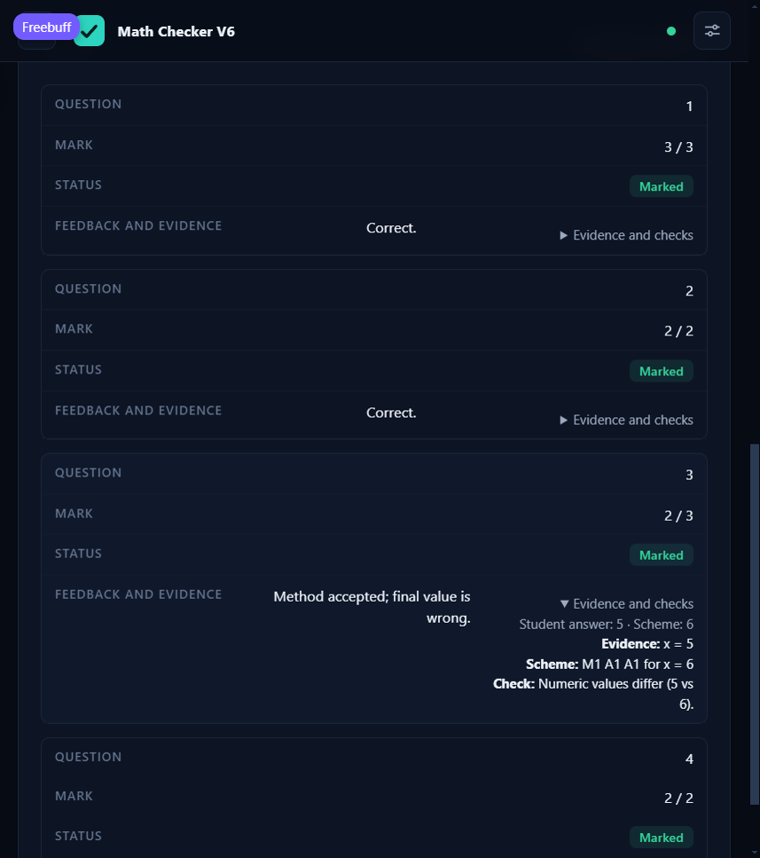
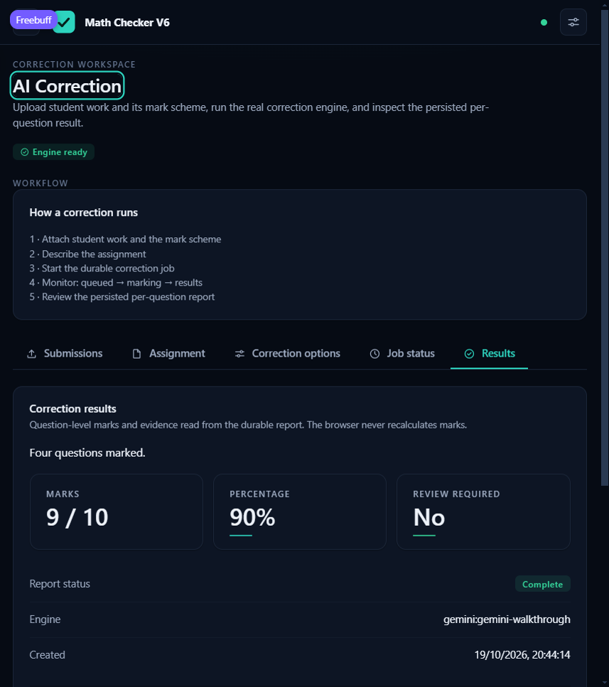

# Math Checker V6 — Phase 5 Test Report

**Date:** 2026-10-19 · Companions: [PHASE5_AUDIT.md](PHASE5_AUDIT.md),
[PHASE5_RELIABILITY_REPORT.md](PHASE5_RELIABILITY_REPORT.md).

## 1. Commands and final results

| Suite | Command | Result |
|---|---|---|
| Backend (all) | `PYTHONPATH=backend .venv/Scripts/python -m pytest backend/tests -q` | **207 passed**, 1 Starlette deprecation warning, exit 0 (17 s) |
| Frontend (all) | `cd frontend && node --test tests/*.test.mjs` | **49 passed**, 0 failed (0.26 s) |
| E2E (CLI) | `.venv/Scripts/python scripts/e2e_walkthrough.py` | **PASS** (see §3) |
| E2E (browser) | `scripts/e2e_walkthrough.py --keep-alive` + real browser | **PASS** (see §4) |

Every suite is offline: no paid API, no network beyond `127.0.0.1`.

## 2. Test inventory (backend 207 total across 23 files)

| Category | Files | What is proven |
|---|---|---|
| Unit: config | `test_config.py` (10) | `MC6_*` parsing ranges, invalid values rejected, live env flags, no secret echo |
| Unit: documents/PDF | `test_correction_documents.py` (14) | magic bytes, encryption, page structure, oversized payloads |
| Unit: scheme/validation | `test_correction_scheme.py` (7), `test_correction_validation.py` (20) | blueprint extraction, label normalisation, marks ≤ maxima, missing → unresolved (never zero), contradictory output rejected, totals recomputed |
| Unit: verify/mark math | `test_correction_verify.py` (8), `test_correction_marking_fixtures.py` (3), `test_v5_reference_fixture.py` (1) | numeric/algebraic checks, known-answer fixtures vs the V5 reference run (9/10) |
| Unit: provider | `test_correction_provider.py` (8) | bounded retries, retryable classes only, truncation/safety/empty handling |
| Unit: storage | `test_storage.py` (12), `test_db.py` (7) | settings, submissions, results uniqueness, migrations, newer-schema refusal |
| Unit: jobs | `test_correction_jobs.py` (10) | validation, lifecycle, idempotency, recovery, workspace cleanup, **fractional-marks persistence + immutable completion (new)** |
| Unit: engine contract | `test_engine.py` (16) | unavailable engine honesty, request policy |
| Integration: API | `test_api_corrections.py` (9), `test_api_system.py` (9), `test_api_settings.py` (6), `test_api_database.py` (2), `test_api_storage.py` (5), `test_api_degraded.py` (3), `test_static.py` (5) | multipart upload → job service → real engine → SQLite → HTTP report; error envelopes; degraded 503s |
| Integration: Classroom | `test_classroom.py` (21) | sync cache writes, OAuth materialisation, **cached-course publish addressing (new)**, **403/429/503 op recording (new)**, canonical in-place re-correction |
| Fixtures/dev | `test_dev_fixtures.py`, `test_services.py` | seed idempotence, stats shape |

## 3. E2E walkthrough (reproducible CLI artifact)

`scripts/e2e_walkthrough.py` boots the **real** `main.py` uvicorn server on a
random port against a scratch data directory, with a local stub Gemini
provider; then fully exercises through real HTTP:

1. `GET /api/health` until ready; `correction_engine.available == true`.
2. `POST /api/corrections` with the bundled V5 student + mark-scheme PDFs
   (real multipart bytes, real idempotency key).
3. Polls `GET /api/corrections/{id}` through `queued → processing → completed`.
4. Asserts the persisted **9 / 10 (90%)** and per-question `[3,2,2,2]` from
   the report endpoint (SQLite, not the engine).
5. Prints the results deep link. Exit code 0 on success.

Output: `[e2e] PASS: upload -> engine -> persisted report -> API verified`.

## 4. E2E browser verification (human-visible workflow)

With `--keep-alive` serving the workflow's own app instance, a real browser
session checked the user path end-to-end:

- Results tab shows **9 / 10**, **90%**, Review required **No**, Report
  status **Complete**, engine label — all read from persisted rows.
- Question rows 1–4 render individual marks (`3/3`, `2/2`, `2/3`, `2/2`) and
  the evidence disclosure for question 3 shows student answer vs scheme
  answer and the deterministic check result, with no console errors and all
  asset/API requests returning 200.

- A full page **reload** re-fetches the persisted report through the
  `?job=` deep link and shows identical marks — the browser never
  recalculates.

(The appliance screenshots above were captured live during this run and are
stored in `screenshots/`.)

## 5. Known-answer marking fixtures (integrity)

`test_v5_reference_fixture.py` + `test_correction_marking_fixtures.py` pin
manually verified cases through the whole validation layer: full-mark
answers, partial credit (M1 method marks), wrong final answers with correct
method, missing/unreadable questions, malformed model output, boundary
maxima. Totals are recomputed and must agree at every layer
(scheme → validation → storage → report).

**Honest limitation (unchanged from Phase 3):** passing these proves the
invariants hold on known cases. It does NOT measure real-world marking
accuracy against unseen submissions; an independently reviewed evaluation
dataset remains future work.

## 6. Could not run / not run

- Live Google Classroom and live Gemini calls: excluded by design from the
  default suite (external, credentialed). Everything is exercised through
  doubles at the network seam.
- Dependency vulnerability scanning tooling is not installed in this
  environment; no `pip-audit` run was possible. Noted as a limitation.

## 7. Frontend tests

Unchanged from baseline (49 pass) — no frontend file was modified in
Phase 5, so the baseline result remains the affected check's result.
