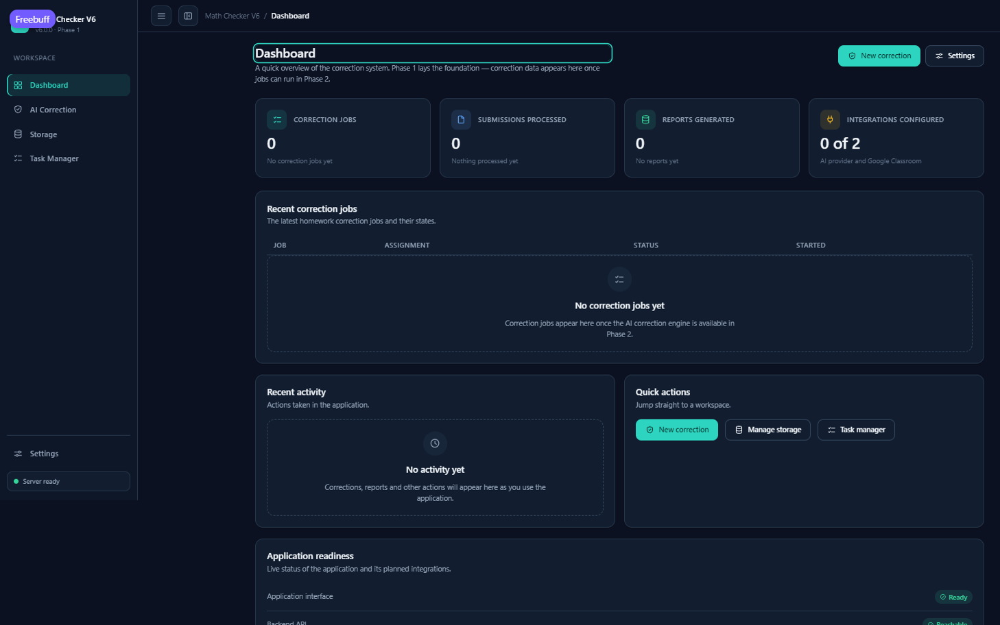
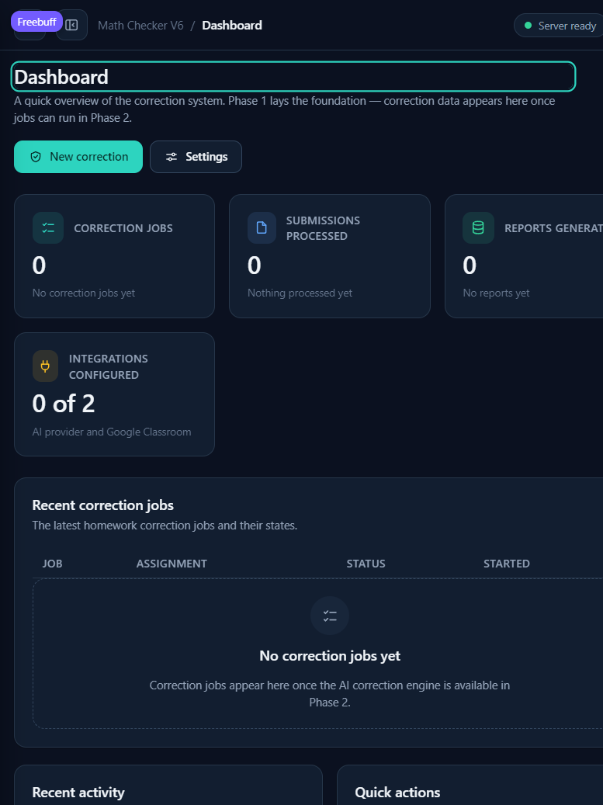
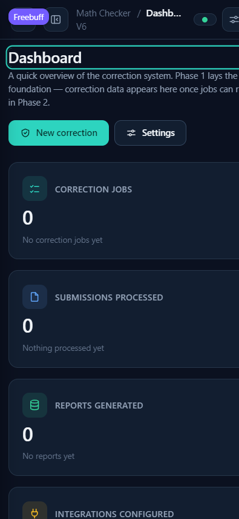
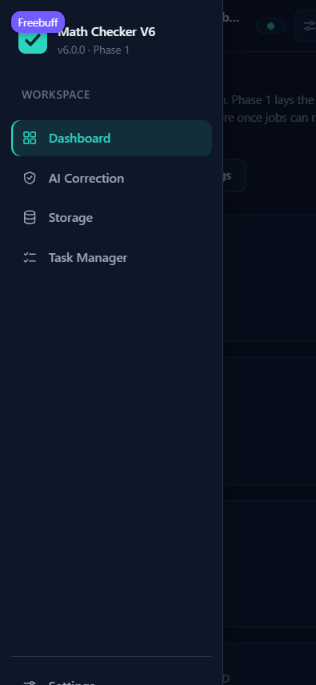
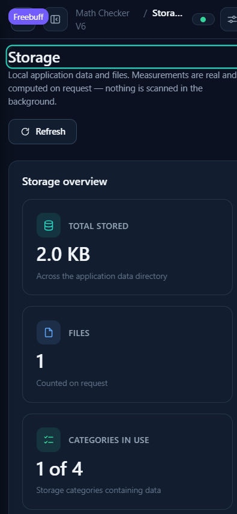

# Math Checker V6 — Phase 1 Completion Report

**Scope:** foundation & UI framework · **Status:** complete · **Version:** 6.0.0 (Phase 1)

> **Roadmap note (added in Phase 2):** this report records the Phase 1 state.
> Phase 2 later added the backend foundation (SQLite storage, settings and
> statistics APIs, degraded-start handling, and live UI wiring). The AI
> correction engine described here as “Phase 2” is now planned for **Phase 3**
> and is specified in `docs/correction-engine-contract.md`.
>
> **Phase 3 update:** the correction engine is implemented in
> `backend/app/correction/` and documented in `docs/phase-3-report.md`.
>
> **Phase 4 update:** uploads, durable jobs, persisted results and the UI
> wiring are implemented and documented in `docs/phase-4-report.md`.

---

## 1. Architecture selected and why

**Small FastAPI backend (2 runtime dependencies) serving a zero-build vanilla
HTML/CSS/ES-module SPA with hash routing.**

- FastAPI + uvicorn is V5's proven serving layer, kept deliberately; the
  React/Vite frontend toolchain was dropped because the brief asked for the
  lightest maintainable option and V5's frontend stack was a major source of
  complexity.
- No build step and no Node toolchain are needed to run the application.
  Pages load on demand via dynamic `import()` (code splitting without a
  bundler).
- Hash routes (`#/dashboard`) make every page directly navigable with zero
  server rewrite configuration — ideal for free-tier hosting.
- Trade-off and the React comparison table: `docs/architecture.md` §2.
- Python 3.14 wheel availability for pydantic was verified before committing
  (fastapi 0.146 + pydantic 2.14 install and run cleanly).

## 2. Files and modules created

```
MATH_CHECKER_V6/
├── main.py                  launcher (config → uvicorn), --host/--port/--version
├── requirements.txt         fastapi, uvicorn (2 runtime deps)
├── requirements-dev.txt     + pytest, httpx
├── .env.example             MC6_* template, placeholders only
├── .gitignore               .env, venvs, data/, caches
├── README.md                setup, launch, testing, troubleshooting
├── docs/architecture.md     decisions + integration boundary for later phases
├── docs/phase-1-report.md   this report
├── docs/screenshots/        verified UI captures
├── backend/app/
│   ├── config.py            MC6_* env vars, minimal stdlib .env loader
│   ├── main.py              FastAPI app, static serving, generic error handler
│   └── api/system.py        GET /api/health, /api/system/status
│   └── api/storage.py       GET /api/storage/summary (bounded, path-free)
├── backend/tests/           conftest + test_config + test_api_system
│                            + test_api_storage + test_static
└── frontend/
    ├── index.html           shell document (local stylesheets, live region)
    ├── css/                 tokens.css, base.css, layout.css, components.css
    ├── js/                  main.js, router.js, api.js, store.js, icons.js, format.js
    ├── js/ui/               html, button, card, badge, form, table, states,
    │                        modal, toast, tabs, pagination
    ├── js/layout/shell.js   sidebar + top bar + drawer + active state
    ├── js/pages/            dashboard, correction, settings, storage, tasks, notfound
    └── tests/               6 node --test suites (zero dependencies)
```

## 3. Pages and interactions implemented

| Page | Real behaviour in Phase 1 |
|---|---|
| **Dashboard** `#/dashboard` | Stat cards with honest zeros ("No correction jobs yet"), empty-state job table and activity feed, quick actions (real navigation), readiness panel **read live from the server** (version, AI/Classroom configuration flags) |
| **AI Correction** `#/correction` | Five tabs. Real browser-side file picker with validation (PDF/PNG/JPG, ≤25 MB), review list with pagination, remove with confirmation modal, assignment/options draft state, jobs/results tabs with honest empty states. "Start correction" is disabled **with a visible explanation** |
| **Settings** `#/settings` | Working preference persistence (start page, density, confirm-before-remove) with Save/Reset + toasts; disabled, clearly-marked placeholders for AI provider and Classroom (collect nothing); real app-info diagnostics (backend version/connection, storage availability) |
| **Storage** `#/storage` | Real per-category measurements from the bounded on-request walk; Refresh re-measures; honest empty state; no deletion/migration |
| **Task Manager** `#/tasks` | The four planned task categories with honest empty states |
| **Not found** | Any unknown hash route shows a deliberate 404 page naming the route |

Shell: collapsible sidebar (persisted), mobile off-canvas drawer (Escape /
overlay / link click closes it), active-page indicator (`aria-current`),
skip link, focus moved to the page heading on navigation, live server-status
chip. No fake notifications, profiles or fabricated metrics anywhere.

## 4. Dependencies added and purpose

| Package | Layer | Purpose |
|---|---|---|
| `fastapi` | runtime | ASGI framework (routing, validation, error handling) |
| `uvicorn` | runtime | ASGI server |
| `pytest` | dev | backend tests |
| `httpx` | dev | Starlette TestClient transport |

Frontend: **zero dependencies**. Icons are hand-drawn inline SVG; fonts are
system fonts; nothing is fetched from any CDN.

## 5. Tests run and actual results

Commands executed in this workspace (2026-10-19):

| Command | Result |
|---|---|
| `.venv/Scripts/python -m pytest backend/tests -q` | **23 passed** (exit 0) |
| `cd frontend && npm test` (→ `node --test "tests/*.test.mjs"`) | **31 passed, 0 failed** (exit 0) |

Covered: route resolution + not-found, nav active state, preference store
(corruption-tolerant serialisation), form validators, escaping, page
rendering a11y attributes, format helpers; backend: health/status shapes,
honest feature flags, secret/path non-leakage, storage categorisation and
bounds/truncation, static serving + content types, traversal safety, config
defaults/overrides/validation/.env precedence.

Three genuine defects were found and fixed during development (render-object
stringification in the router, an identifier shadowing bug, a malformed
`aria-disabled` attribute); regression assertions were added where the test
layer could reach them.

## 6. Production frontend bundle size (measured)

There is no build step; the served assets *are* the production assets.

| | Bytes raw | Bytes gzip |
|---|---|---|
| All frontend app files (HTML+CSS+JS, 30 files) | **105,494** | **34,818** |
| Largest single file (`pages/correction.js`) | 13,771 | 4,090 |
| Per-page modules | 786–13,771 | 437–4,090 |

Well inside the ≤200 KB gzip budget. Initial page load fetches shell +
dashboard only (~60 KB raw / ~20 KB gzip); other pages arrive on demand.

## 7. Startup and idle resource measurements (measured)

| Measurement | Result | Method |
|---|---|---|
| Cold start to first HTTP 200 (`/api/health`) | **~1.2 s** | fresh `python main.py --port 8652`, polled every 50 ms |
| Idle memory (server process) | **~57 MB** working set (+4.6 MB venv launcher shim) | `Win32_Process WorkingSetSize`, idle server |
| Background services started | **none** — single process, no workers, no polling | design + process list |
| Dashboard data requests | 1 (`/api/system/status`, shared/memoised with top bar) | browser network log |
| Runtime Python packages | **14** (2 direct) | `pip freeze` in a clean venv with `requirements.txt` |

## 8. Known bugs and limitations

- **No automated browser (E2E) tests.** A browser automation framework would
  violate the dependency budget; interactions were verified manually in a
  real browser (see §9). Unit + API tests cover the logic.
- **Screenshot captures on this host clip a few pixels at the right edge**
  when wide viewports are emulated (capture-region limitation of the tooling,
  not the app). Layout metrics at those sizes were verified numerically
  instead (bounds + `scrollWidth` checks); captures in `docs/screenshots/`
  are scaled to fit and are illustrative.
- Preference storage is per-browser (localStorage). A future account system
  would move preferences server-side.
- Correction drafts live in page memory for the session; persistent drafts
  arrive with later-phase processing.
- Light/dark theme switching is not offered (dark theme only), though all
  colours are tokens and could support one later.

## 9. Verification performed (browser, real interactions)

- All five routes + `#/definitely-missing` not-found: render, titles, active nav.
- Sidebar collapse/expand (64 px rail, `aria-pressed`, persisted) and mobile
  drawer open/close incl. **Escape**.
- Keyboard: Tab order through shell controls, Enter activates navigation,
  focus lands on the page heading after route changes.
- AI Correction: added valid + invalid files (accepted/rejected with clear
  messages), toasts, pagination hooks, remove → confirmation modal (role,
  focus moved inside) → confirm → removed.
- Settings: changed density → Saved → toast → persisted across reload →
  Reset restores defaults. Diagnostics show live backend values.
- Storage: Refresh reflects a file created server-side immediately
  (2.0 KB / 1 file / correct category) — measurements are real.
- Responsive (measured `scrollWidth` ≤ viewport at all sizes — no overflow):
  1440×900, 1280×720, 768×1024 (drawer mode, cards wrap 3+1), 390×844
  (single column, stacked table with data labels, truncated breadcrumb).
- Browser console: **no errors** across the whole session.











## 10. Features deliberately deferred (later phases)

AI correction logic · Gemini/provider integration & key rotation · PDF
extraction & maths-expression recognition · mark-scheme verification · grade
calculation/submission · Google Classroom sync · student reports · background
correction workers · multi-account/multi-school · authentication · database
migrations · deployment automation. The integration seam for each is
documented in `docs/architecture.md` §6; the UI marks each as planned.

## 11. Verification checklist (brief against the spec)

**Startup** — clean venv install works from README steps; starts with one
command (`python main.py`) **without any AI key**; host/port configurable via
`MC6_*` env or `--host/--port`; no background services. ✔

**Navigation** — every page opens; direct URLs work; unknown routes show the
404 page; active item tracks the route; collapse/expand works; keyboard
navigation works. ✔

**UI** — shared components + tokens throughout; every control has defined
behaviour; empty states honest ("No correction jobs yet"); no placeholder
data presented as real; usable at all four viewports with no overlap/clipping
or horizontal overflow; forms labelled with validation on the file picker. ✔

**Quality** — no startup errors; no console errors; no broken internal links;
no credentials anywhere (`.env` ignored, `.env.example` placeholders only);
V5 untouched (see §12); no heavyweight dependencies; both test suites pass. ✔

**Performance** — frontend 105 KB raw / 34 KB gzip measured; startup ~1.2 s
and idle ~57 MB measured; dashboard issues exactly one status request. ✔

**Documentation** — README matches the code; implemented vs deferred clearly
separated here and in the UI; limitations recorded; the engine boundary is
documented. ✔

## 12. Confirmation that V5 was left unchanged

- All work was performed inside `MATH_CHECKER_V6` only.
- Before work began: `git -C MATH_CHECKER_V5 status --short` was **clean**.
- After completion: same command again — **clean**, HEAD unchanged at
  `e0b3e3317e58f91ea7bd5a4eacac16b8f057f08e` ("Protect app data and expand
  dashboard coverage"). No V5 file was read for writing, copied or modified.

## 13. Acceptance criteria

**Met.** The deliverables in the brief §13 are all present: runnable project,
complete shell, all Phase 1 pages, working navigation, reusable component
library, centralised design tokens, responsive layouts, minimal dependency
manifest with reproducible install, `.env.example`, `.gitignore`, README,
`docs/architecture.md`, this report, automated tests for routing and core
interactions, and a single-command launch. The definition of success — a
polished, consistent, lightweight, working UI foundation extendable without
another architectural rebuild — is satisfied; Phase 3 plugs into the seams
documented in `docs/architecture.md` §6.
